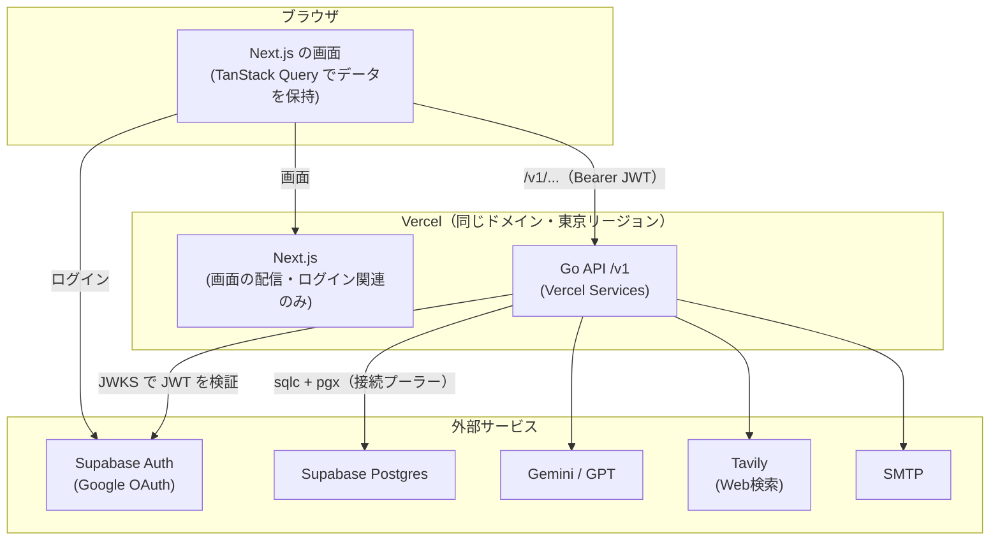
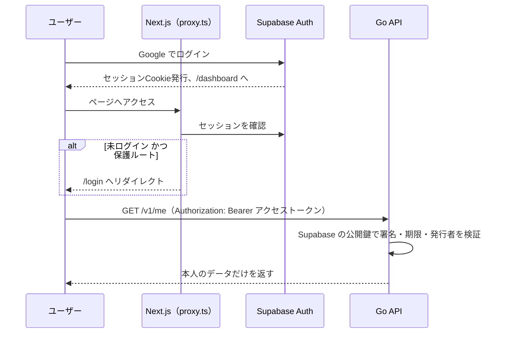
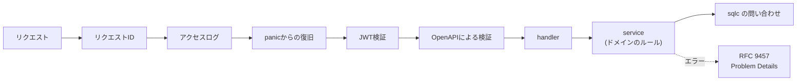
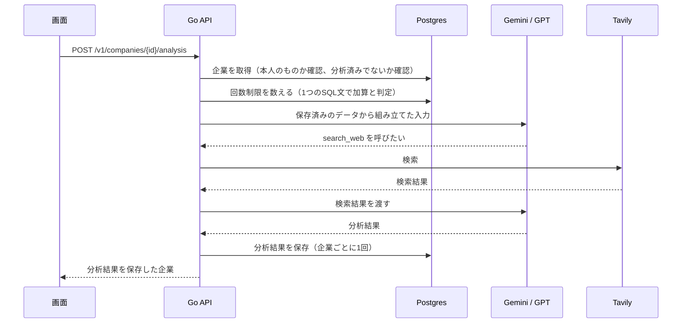
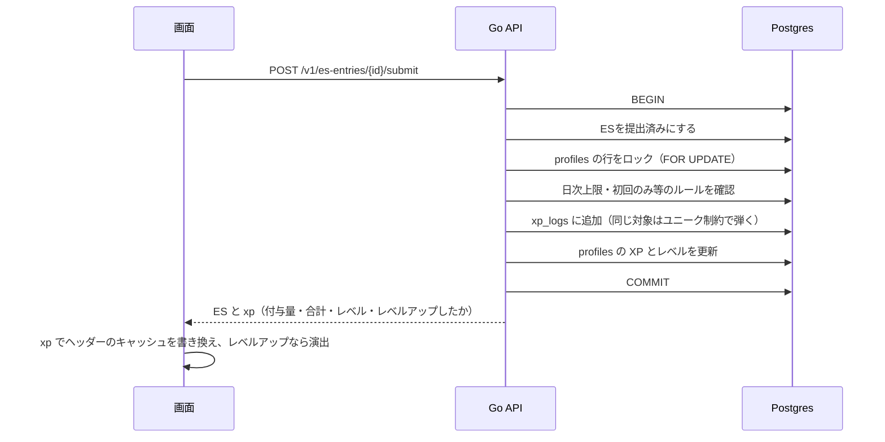
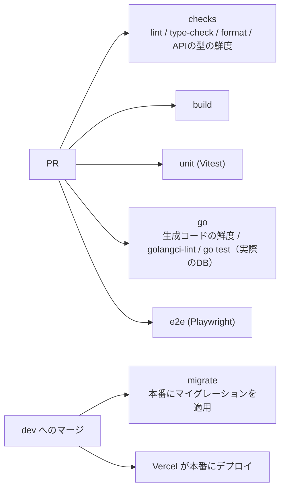
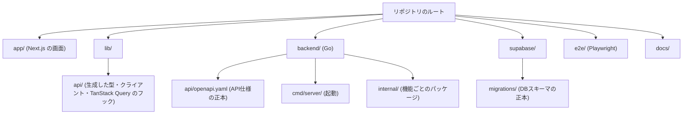

# アーキテクチャ概要

このドキュメントはコードベース全体の構造と主要フローを図解する。個別の詳細ルールは [CLAUDE.md](../CLAUDE.md) を、設計の判断とその理由は [backend-design.md](./backend-design.md) を、DBスキーマは [database-schema.md](./database-schema.md) を、テストの設計は [testing/](./testing/) を参照。

## 全体構成

Next.js は画面だけを担当し、データの読み書き・外部APIの呼び出し・ビジネスロジックはすべてバックエンドが担当する。ブラウザはバックエンドのAPIを直接呼ぶ（SPA型）。

`vercel.json` の Services が、`/v1/*` をバックエンドに、それ以外を Next.js に振り分ける。同じドメインなので CORS は不要。

## 認証フロー

- バックエンドは検証したトークンからだけユーザーIDを取り出し、すべての問い合わせを `user_id` で絞り込む
- ログインが必要かどうかは `openapi.yaml` の `security` で決まる
- RLS は全テーブルで有効だが、ポリシーは作らない。Supabase の Data API を塞ぐためだけに使う

## リクエストの流れ（Go）

- 入力の形式（必須・文字数・enum）は `openapi.yaml` の定義でミドルウェアが弾き、ドメインのルールは service が確かめる
- エラーは `platform.Error` から Problem Details への変換を1か所で行う

## AI連携

- AIへの入力は画面から受け取らず、バックエンドが保存済みのデータから組み立てる。結果の保存まで1つの操作で行う
- AIは時間がかかるため、DBのトランザクションの外で呼ぶ。「1回だけ」の制限は、保存時の条件（`ai_result is null`）で守る

## XP（ゲーミフィケーション）フロー

## テスト・CI

- バックエンドのDBを使うテストは、Supabase の Postgres イメージをサービスコンテナとして起動し、マイグレーションを当ててから実行する
- E2E は本番ビルドの Next.js だけを起動しているため、バックエンドに移した画面のE2Eは一時停止している（CLAUDE.md の「テスト」参照）

## ディレクトリ構成の要点

## 既知の技術的負債（アーキテクチャ観点）

- E2E がバックエンドを起動しておらず、バックエンドに移した画面をE2Eで確かめられない
- `error.tsx` / `loading.tsx` / `not-found.tsx` がリポジトリ全体に1つも無く、例外がNext標準のクラッシュ画面になる（Issue #109）
- ライトテーマは `globals.css` の属性セレクタによるハードコード色の力技上書きで、脆弱な構造（Issue #116、#91で本格対応予定）
