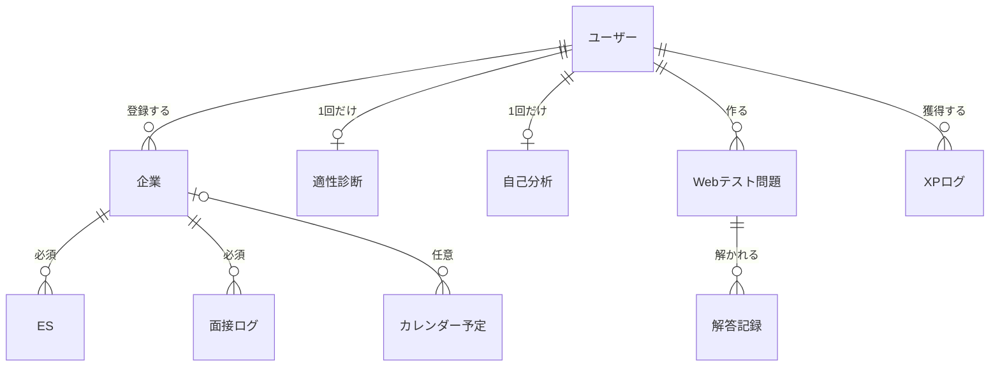
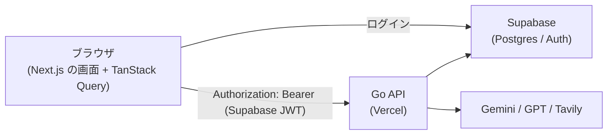

# バックエンド設計（Go移行）

Next.js の Route Handler / Server Action に散らばっているビジネスロジックとDBアクセスを、Go のバックエンドへ移すための設計書。設計は 2026-10-10 に確定した。実装中に判断が変わった場合は、この文書を更新してから実装する。

現行の構成は [architecture.md](./architecture.md)、現行のスキーマは [database-schema.md](./database-schema.md) を参照。いずれもGo移行の完了時に、この設計に合わせて書き換える。

## 0. 目的と範囲

- **目的**: ビジネスロジックを Next.js から切り離すこと。Goの学習も兼ねる
- **バックエンドの責務**: DBアクセス、外部API（AI・Tavily・SMTP）の呼び出し、ビジネスロジックのすべて
- **Next.jsの責務**: 画面だけ
- **Supabaseの役割**: Postgres と Auth（Google OAuth）だけを使う。RLS と supabase-js によるデータアクセスはバックエンドに置き換える
- **費用**: 0円（すべて無料プラン）

### 言語をJavaからGoに変えた理由

当初は Java（Spring Boot）で進めていたが、Vercel は JVM を動かせない。Javaにすると実行環境を別のサービスとして増やす必要があり、Spring Boot は起動が遅いため、無料プランではコールドスタートが重くなる。Goなら Vercel 上で動かせ、起動も速い。Goも学びたかったため、Javaの学習成果は捨てた。

## 1. 棚卸しで見つかった問題

| 問題                                                                                           | 対応                                                         |
| ---------------------------------------------------------------------------------------------- | ------------------------------------------------------------ |
| XP付与が「読んでから書く」作りで、同時リクエストで二重付与・加算漏れ・日次上限超過が起こりうる | トランザクションと行ロックで直す（6章）                      |
| レート制限も同様に、同時リクエストで上限を超えられる                                           | 1つのSQL文で加算と判定を行う（6章）                          |
| AIの結果をクライアントが別リクエストで送って保存しており、任意の文字列を保存できる             | AIの呼び出しと保存をバックエンドの1つの操作にまとめる（5章） |
| `updated_at` が更新時に変わらない（ES一覧が実は作成順）                                        | トリガーで自動更新する（4章）                                |
| ESと面接ログが企業名を文字列で持っており、`companies` とつながっていない                       | 企業を中心にして `company_id` で結ぶ（3章）                  |
| `createEsEntryAction` / `createCompanyAction` と関連スキーマがどこからも使われていない         | 別のPRで削除する                                             |
| CLAUDE.md の「ES削除時にカレンダーも削除」は誤り（ESの締切は表示時にESから組み立てている）     | 別のPRで修正する                                             |

## 2. 要件

### 機能要件

- ビジネスルールは画面ではなく**操作**に結び付ける。どの画面から行っても同じ操作なら同じルールが適用される
- AIの呼び出しと結果の保存は、サーバー側で1つの操作にする
- 用語（3章）とエラー形式（5章）を統一する
- XP付与とレート制限は、同時にリクエストが来ても仕様どおりに動く

### 非機能要件

| 項目         | 要件                                                                                                     |
| ------------ | -------------------------------------------------------------------------------------------------------- |
| 性能         | 通常のAPIは1秒以内。AI系は数十秒かかってよい                                                             |
| 可用性       | ベストエフォート（無料プランの範囲）                                                                     |
| セキュリティ | 認可は必ずバックエンドで行う。すべての入力をバックエンドで検証する（フロントの検証は使い勝手のためだけ） |
| ログ         | リクエストIDとユーザーID付きの構造化ログ。外部の監視サービスは使わない                                   |
| テスト       | ビジネスロジックは単体テスト、同時実行の正しさは実際のDBを使ったテストで確かめる                         |
| 費用         | 0円                                                                                                      |

## 3. ドメイン

### エンティティ



- **企業が中心**。ESと面接ログは企業の指定が必須、カレンダー予定は任意
  - 採らなかった案: 企業名を文字列のまま持つ。表記揺れ・名前変更・企業ごとの集約ができないため
- 企業を削除すると、ひも付くES・面接ログ・予定も削除する（画面では確認ダイアログを出す）
- 企業名は正規化（「株式会社」「(株)」「㈱」、空白、全角・半角の違いを除く）した名前でユーザーごとに一意
  - 採らなかった案: ユーザーが自分で企業を統合する機能。必要になってから作る
- 企業を選ぶ画面（ES・面接ログ・カレンダー）では、登録済みの企業を候補に出し、その場で新規登録もできる。外部の企業データベース（法人番号API等）からの候補はリプレイス後の機能追加とする
- カレンダーには、ユーザーが登録した予定に加えて、ESの締切を自動で表示する
- 選考状況は次の7つから選ぶ。状態の移り方に制限は設けない（実際の選考は行き来するため）
  - 未エントリー／エントリー済み／書類選考／面接中／内定／不合格／辞退
  - 「カジュアル面談」は選考段階ではないので含めない
- ESの提出は取り消せない（提出後も内容は編集できる）
- 面接の「雛形」機能は廃止する（使われていないため）

### 用語

| 対象         | 操作名（画面） | 保存されるもの | Goの型              |
| ------------ | -------------- | -------------- | ------------------- |
| ES           | AI添削         | 添削結果       | `EsReview`          |
| 面接ログ     | AI振り返り     | 振り返り結果   | `InterviewReview`   |
| 企業         | AI企業分析     | 分析結果       | `CompanyAnalysis`   |
| 適性チェック | AI適性診断     | 診断結果       | `AptitudeDiagnosis` |
| 自己分析     | AI自己分析     | 分析結果       | `SelfAnalysis`      |

「サマリー」「要約」「AI回答」は使わない。「回答」はユーザーの入力（`answers`）だけを指す。

### XPのルール

レベル = XP ÷ 25（切り捨て）＋ 1。

| 操作                     | XP  | 制限                            |
| ------------------------ | --- | ------------------------------- |
| ESを提出する             | 25  | 同じESには1回だけ、1日5回まで   |
| 面接ログを作る           | 20  | 同じログには1回だけ、1日5回まで |
| 企業を登録する           | 5   | 1日5回まで                      |
| 適性診断・自己分析を行う | 15  | 初回だけ                        |
| Webテストの問題を作る    | 5   | 1日3回まで                      |
| Webテストに解答する      | 15  | 1日2回まで                      |

ESの提出に日次上限を設けたのは、「提出 → 削除 → 作り直して提出」でXPを稼げる抜け道を塞ぐため。

### AIのルール

| 機能                   | 再実行                                         | 1人1日の上限         |
| ---------------------- | ---------------------------------------------- | -------------------- |
| AI添削・AI振り返り     | 何度でも（添削は履歴を残し、振り返りは上書き） | 汎用AIとして合計20回 |
| AI適性診断・AI自己分析 | 1回だけ                                        | 汎用AIの20回に含む   |
| AI企業分析             | 企業ごとに1回だけ                              | 3回                  |

- 適性診断・自己分析は何度もやるものではなく、AIの費用も抑えたいため1回だけとする
- 企業分析の上限が厳しいのは、Tavilyの無料枠（月1,000クレジット程度）に対し、1回で最大3回検索するため
- サービス全体の上限は、利用者が増えてから検討する
- 再実行の可否と上限は、画面ではなくバックエンドで強制する

## 4. データ

本番に残すべきデータがないため、`public` スキーマは新しい設計で**最初から作り直す**。Supabase Auth のユーザーは残す。プロフィールの行がないユーザーは、最初の `GET /v1/me` でバックエンドが行を作る。

### enum型

決まった値の列は Postgres の enum にする。値は英語のコードとし、日本語の表示名はフロントエンドに置く。

| 型                    | 値                                                                                                                                                   |
| --------------------- | ---------------------------------------------------------------------------------------------------------------------------------------------------- |
| `company_stage`       | `not_entered`, `entered`, `screening`, `interviewing`, `offered`, `rejected`, `declined`                                                             |
| `es_status`           | `draft`, `submitted`                                                                                                                                 |
| `calendar_event_type` | `es`, `interview`, `intern`, `other`                                                                                                                 |
| `interview_format`    | `in_person`, `online`, `hybrid`                                                                                                                      |
| `xp_action`           | `es_submitted`, `interview_log`, `company_new`, `aptitude_complete`, `self_analysis_complete`, `webtest_question_create`, `webtest_attempt_complete` |

- enumは定義順に並べ替えられる（選考状況を進み具合順に並べられる）。値の追加・改名はできるが、削除には型の作り直しが必要
- 採らなかった案: `text` ＋ CHECK制約、マスタテーブル

### テーブル

共通: すべての `user_id` は `not null`。`updated_at` を持つテーブルは `moddatetime` トリガーで自動更新する。

| テーブル                                     | 列                                                                                                                                             | 備考                                                                                   |
| -------------------------------------------- | ---------------------------------------------------------------------------------------------------------------------------------------------- | -------------------------------------------------------------------------------------- |
| `profiles`                                   | id, full_name, university, faculty, avatar_id, target_industry, career_axis, goal_state, xp, level, created_at, updated_at                     | XPとレベルは保存する（下記）                                                           |
| `companies`                                  | id, user_id, name, normalized_name, industry, url, mypage_id, mypage_url, memo, stage, preference, favorite, ai_result, created_at, updated_at | `(user_id, normalized_name)` がユニーク。`preference` は1〜5                           |
| `es_entries`                                 | id, user_id, company_id, position, title, status, content_md, questions, tags, deadline, memo, ai_result, created_at, updated_at               | `position` は職種・募集枠（自由入力）。企業のURLは `companies.url` に一本化            |
| `es_reviews`                                 | id, user_id, es_entry_id, ai_result, created_at                                                                                                | ESのAI添削の履歴（点数の推移を見せるため上書きしない）                                 |
| `interview_logs`                             | id, user_id, company_id, format, round, interview_date, questions, improvement, unexpected, ai_result, created_at, updated_at                  | `round` は面接の回次（自由入力）。`questions` は質問と回答の一覧だけを持つ             |
| `calendar_events`                            | id, user_id, company_id（任意）, title, type, date, time, created_at, updated_at                                                               | `time` は `time` 型                                                                    |
| `xp_logs`                                    | id, user_id, xp, action, ref_id, created_at                                                                                                    | `(user_id, action, ref_id)` がユニーク。`(user_id, action, created_at)` にインデックス |
| `aptitude_results` / `self_analysis_results` | id, user_id, answers, ai_result, created_at                                                                                                    | `user_id` がユニーク                                                                   |
| `webtest_questions` / `webtest_attempts`     | 現行どおり                                                                                                                                     |                                                                                        |
| `api_rate_limits`                            | user_id, bucket, window_start, count                                                                                                           | AIの1日の上限も `bucket` を分けてここで管理する                                        |

`company_id` の外部キーはすべて `on delete cascade`。

### 個別の判断

- **AI結果の列名は全テーブルで `ai_result`**。用語集の名前（添削結果など）はGoの型と画面で使い、DBは共通の名前にする
- **AIのトークン数は、`ai_result` と同じ行の `ai_input_tokens`・`ai_output_tokens` に残す**。開発者ダッシュボードで機能ごとに集計する。思考・推論の分は出力に含める。呼び出しごとの別テーブルは作らず、上書きする機能・1回だけの機能では最新の1回分だけが残る
- **XPとレベルは `profiles` に保存する**。採らなかった案: 毎回 `xp_logs` から合計を計算する。保存する代わりに、付与は必ずトランザクション内で `xp = xp + n` とアトミックに更新する。レベルの計算式を変えたら全ユーザーの `level` を計算し直す必要がある
- **正規化した企業名はバックエンドで計算して保存する**。採らなかった案: DBの生成列。正規化はドメインのルールなので、Goの単体テストで確かめられる形にする。DBに書き込むのはバックエンドだけなので、バックエンド以外から書かれる心配はない。重複はDBのユニーク制約が最後に止める
- **法人番号の列は今は作らない**。外部の企業データから候補を出す機能を作るときに追加する
- 現行から削除する列: `es_entries.company_name` / `company_url` / `score`、`interview_logs.company_name` / `self_review`、`calendar_events.company`

## 5. API

### 呼び出し経路

ブラウザがバックエンドのAPIを直接呼ぶ（SPA型）。Next.jsは画面だけを担当する。



- 理由: 操作の速さ（画面移動のたびにサーバーを経由しない）と、役割の分離（Next.jsは画面だけ）
- 採らなかった案: Next.js のサーバーを経由する BFF 型。移行は楽だが、Next.js もデータ取得を担うことになり、画面移動のたびにサーバーを経由する
- ブラウザでのデータ保持には **TanStack Query** を使う。「1つの更新で複数のデータが変わる」場面（提出でXPが変わる、企業削除でESが消える等）で、関連キャッシュをまとめて無効化できるため。導入時に CLAUDE.md の状態管理のルールを「サーバーのデータのキャッシュには TanStack Query を使う。Redux・Zustand などの汎用の状態管理ライブラリは使わない」に書き換える

### 契約（OpenAPI、スキーマファースト）

`openapi.yaml` を唯一の正とし、GoとTypeScriptのコードを生成する。フロントとバックエンドに差異が出ないよう、次の4つをそろえる。

1. バックエンドは仕様から生成したインターフェースを実装する（`oapi-codegen` の strict server）
2. リクエストを仕様と照らし合わせて検証する（`kin-openapi` のミドルウェア）
3. 生成コードが古いままならCIで失敗させる
4. フロントは生成されたクライアント経由でAPIを呼ぶ

採らなかった案: Connect RPC。Goと同時に Protocol Buffers を学ぶ負担が大きく、RESTの方が汎用的な知識になるため。

### 規約

| 項目   | 規約                                                                                                                                                                                                                          |
| ------ | ----------------------------------------------------------------------------------------------------------------------------------------------------------------------------------------------------------------------------- |
| URL    | `/v1` から始める。リソース名は複数形のハイフン区切り（`/es-entries`）。入れ子にせず、企業での絞り込みはクエリ（`?companyId=`）                                                                                                |
| JSON   | camelCase。DBのsnake_caseからの変換はバックエンドで行う                                                                                                                                                                       |
| 日時   | ISO 8601のUTC。日付は `2026-10-10`、時刻は `14:30`                                                                                                                                                                            |
| ID     | UUIDの文字列                                                                                                                                                                                                                  |
| 更新   | PATCH（送った項目だけを更新）                                                                                                                                                                                                 |
| 一覧   | ページ分割なし。必要な場面だけ `limit`。1人あたりの件数に上限を設け（企業・ES・面接ログは500、予定は2000）、長い列は詳細だけで返す                                                                                            |
| 成功時 | 作成 `201`、削除 `204`、それ以外 `200`                                                                                                                                                                                        |
| エラー | RFC 9457（Problem Details）＋拡張項目 `code`（英語の機械向けコード）と `errors`（項目ごとのエラー）。バックエンドは日本語のメッセージも返し、フロントは基本的にそのまま表示して、特別な表示が必要な `code` のときだけ分岐する |

### ドメインの操作

- ルールを伴う操作は専用のエンドポイントにする（例: `POST /v1/es-entries/{id}/submit`）。`PATCH` では `status` を変更できない
- XPが付く操作のレスポンスには `xp: { awarded, total, level, leveledUp }` を含める。付かなかった場合も `awarded: 0` で返す
- AIへの入力はバックエンドが保存済みのデータから組み立てる。画面は先に内容を保存してからAIのAPIを呼ぶ（クライアントが送った文章をAIに渡さない）
- AIの結果どうしをつなぐ。AI添削には、そのESの企業の分析結果（求める人物像）と自己分析の分析結果も渡し、「企業との一致」の採点と、強みを活かせているかの指摘に使う
- AIの結果はすべて、完成してからJSONで返す（ストリーミングしない。7章の理由による）

### エンドポイント

すべて `/v1` から始まり、`/health` 以外はログインが必要。ログイン・ログアウト・OAuthのコールバックは Next.js と Supabase Auth のまま。

| メソッド             | パス                                | 内容                                             |
| -------------------- | ----------------------------------- | ------------------------------------------------ |
| GET / PATCH          | `/me`                               | プロフィール・XP・レベル・開発者かどうか／更新   |
| GET                  | `/xp-logs?limit=`                   | XPの獲得履歴                                     |
| GET / POST           | `/companies?q=`                     | 一覧（`q` で正規化名による候補検索）／登録（XP） |
| GET / PATCH / DELETE | `/companies/{id}`                   | 削除するとES・面接ログ・予定も削除               |
| POST                 | `/companies/{id}/analysis`          | AI企業分析（1回だけ）                            |
| GET / POST           | `/es-entries?companyId=&limit=`     | 一覧／作成（常に下書き）                         |
| GET / PATCH / DELETE | `/es-entries/{id}`                  |                                                  |
| POST                 | `/es-entries/{id}/submit`           | 提出（XP、取り消し不可）                         |
| GET / POST           | `/es-entries/{id}/reviews`          | AI添削の履歴／AI添削                             |
| GET / POST           | `/interview-logs?companyId=&limit=` | 一覧／作成（XP）                                 |
| GET / PATCH / DELETE | `/interview-logs/{id}`              | 削除は今回新設                                   |
| POST                 | `/interview-logs/{id}/review`       | AI振り返り                                       |
| GET / POST           | `/calendar-events?from=&to=`        | 一覧はESの締切を混ぜて、種類を区別して返す／作成 |
| PATCH / DELETE       | `/calendar-events/{id}`             |                                                  |
| GET / POST           | `/aptitude-result`                  | 回答の取得／保存（1回だけ、XP）                  |
| POST                 | `/aptitude-result/diagnosis`        | AI適性診断（1回だけ）                            |
| GET / POST           | `/self-analysis-result`             | 同上                                             |
| POST                 | `/self-analysis-result/analysis`    | AI自己分析（1回だけ）                            |
| GET / POST           | `/webtest-questions`                | 一覧／作成（XP）                                 |
| GET                  | `/webtest-questions/{id}`           | 問題と解答記録                                   |
| POST                 | `/webtest-questions/{id}/attempts`  | 解答。正誤はバックエンドが判定（XP）             |
| POST                 | `/contact`                          | 問い合わせメール送信                             |
| GET                  | `/admin/stats`                      | 開発者向けの件数集計                             |
| GET                  | `/health`                           | 稼働確認。DBへの疎通も確かめる（ログイン不要）   |

ダッシュボード専用のエンドポイントは作らず、一覧系APIを組み合わせる。TanStack Query のキャッシュを他の画面と共有できるため。

## 6. アーキテクチャ

### 認証・認可

- バックエンドは Supabase の公開鍵（JWKS）でJWTの署名と有効期限を検証する。ユーザーIDは検証したトークンから取り出したものだけを使う
  - Supabase プロジェクトの署名方式を非対称鍵にしておく必要がある
  - 採らなかった案: 共有の秘密鍵（漏れるとなりすましが可能）、毎回 Supabase に問い合わせる（遅い）
  - ログアウト後も、発行済みトークンは期限（標準1時間）まで有効。扱うデータからみて許容する
- **RLSは有効のまま残す**。Supabase がインターネットに公開している Data API を守るため（RLSを外すと `anon` キーで全データを読める）。ポリシーは1つも作らず、`anon` / `authenticated` ロールからは一切読み書きできないようにする
- バックエンドはRLSを通らないロールで接続し、すべての問い合わせを `userID` で絞り込む。DBにアクセスする関数は `userID` を必須の引数にし、他人のIDでは取得できないことをテストで確かめる
  - 採らなかった案: RLSを二層目の防御として効かせる。堅いが、トランザクションごとにユーザーをDBに伝える仕組みが複雑になる
- 使われなくなった Data API は、公開するスキーマを `graphql_public` だけにして閉じる（`infra/supabase.tf`）。Data API 自体を止める設定は Management API に無いため
- Supabase のAPIキーは、ブラウザ用の publishable キーだけを使う。従来の `anon` / `service_role` キーは無効にし、全権限の secret キーは発行しない。使い道がE2Eのテストユーザーの作成だけで、漏れたときの被害が大きすぎるため（E2Eは手元・CIの Supabase で行う）

### コードの構成

機能ごとにパッケージを分け、各パッケージの中を3層に分ける（採らなかった案: 層ごとのフォルダ、クリーンアーキテクチャ）。

```
backend/
├── cmd/server/main.go      # 起動。依存関係を組み立てる
├── api/openapi.yaml        # API仕様（唯一の正）
└── internal/
    ├── company/            # handler.go / service.go / repository.go
    ├── es/
    ├── interview/
    ├── calendar/
    ├── aptitude/
    ├── selfanalysis/
    ├── webtest/
    ├── profile/
    ├── xp/                 # XP付与（各機能のサービスから呼ぶ）
    ├── ai/                 # Gemini / GPT / Tavily とプロンプト
    ├── ratelimit/          # レート制限と1日の上限
    ├── auth/               # JWTの検証
    └── platform/           # DB接続、ログ、エラー形式など
```

- handler はHTTPの入出力だけ、service はドメインのルール、repository はSQLだけを担当する
- Vercel の Go ランタイムは `cmd/server/main.go` を入口として自動で見つけ、環境変数 `PORT` で待ち受けるサーバーとして動かす（7章）

### DBアクセスとマイグレーション

- **sqlc ＋ pgx**。SQLを書き、型付きのGo関数を生成する。トランザクションは service 層から pgx で扱う
  - 採らなかった案: GORM（実行されるSQLが見えにくく、アトミックな更新や行ロックを書きにくい）、生のpgx（結果の詰め替えを毎回手で書く）
- **Supabase CLI のマイグレーション**（`supabase/migrations/`）。ローカルは `supabase start` で Supabase 一式を動かす。sqlc は `supabase/migrations/` を読み込む
  - 採らなかった案: goose などGo側のツール。素のPostgresには `auth.users` がなく、テスト用の代替が必要になるため

### 同時実行

- **レート制限**: 1つのSQL文で加算と判定を同時に行う

  ```sql
  insert into api_rate_limits (user_id, bucket, window_start, count)
  values ($1, $2, now(), 1)
  on conflict (user_id, bucket) do update set
    count        = case when api_rate_limits.window_start < now() - $3 then 1 else api_rate_limits.count + 1 end,
    window_start = case when api_rate_limits.window_start < now() - $3 then now() else api_rate_limits.window_start end
  returning count, window_start;
  ```

- **XP付与**: ユーザーの `profiles` の行をロックして、同じユーザーの付与を1つずつ処理する。付与は元の操作（ESの提出など）と同じトランザクションで行う
  - 採らなかった案: SERIALIZABLE（やり直し処理が必要）、アドバイザリーロック（行ロックより利点がない）

  ```
  begin
    select ... from profiles where id = $1 for update
    日次上限・初回のみ等のルールを確認
    xp_logs に1行追加（ユニーク制約違反なら付与しない）
    update profiles set xp = xp + $n, level = ...
  commit
  ```

### 共通の仕組み

| 仕組み             | 方針                                                                                                                                                                       |
| ------------------ | -------------------------------------------------------------------------------------------------------------------------------------------------------------------------- |
| ミドルウェアの順番 | リクエストID → ログ → panicからの復旧 → JWT検証 → OpenAPIによる検証 → handler。復旧をIDとログより内側に置き、panicのログにもリクエストIDと結果のステータスが残るようにする |
| ログ               | `log/slog` のJSON。リクエストIDとユーザーIDを付ける                                                                                                                        |
| エラーの変換       | service はドメインのエラーを返し、Problem Details への変換は1か所で行う。想定外のエラーは利用者に詳細を返さずログにだけ出す。リプレイス後のSlack通知はここに差し込む       |
| CORS               | 不要。Next.js と同じドメインで動くため（7章）                                                                                                                              |
| 設定               | すべて環境変数。足りなければ起動しない                                                                                                                                     |
| タイムアウト       | 通常10秒、AIは60秒、企業分析はより長く（Vercelの上限300秒以内）                                                                                                            |
| AIキーがないとき   | 仮の応答を返し、サーバーは止めない                                                                                                                                         |

## 7. インフラ

- **バックエンドは Vercel で動かす**。管理するサービスを増やさず、運用の手間を減らすため
  - 採らなかった案: Google Cloud Run（設計どおりに動くが、サービスとカード登録が増える）、Render の無料プラン（停止からの再開が遅い）
- Vercel の Go ランタイムは `http.Flusher` に対応しておらずSSEが使えないため、**企業分析はストリーミングをやめ、完成してからJSONで返す**。画面は「分析中」の表示にする。進み具合の表示は、必要になってから検討する
- Hobby プランの関数の実行時間の上限は300秒
- Next.js と同じプロジェクトに置くには Vercel の **Services**（ベータ）を使う。ルートの `/api` にGoのファイルを置くと、Next.js のAPIルートが404になる不具合が報告されているため
  - `vercel.json` で、`/v1/...` をバックエンド（`backend/`）に、それ以外を Next.js に振り分ける。バックエンドにはパスがそのまま届く（`/v1/health` はバックエンドでも `/v1/health`）
  - Next.js と同じドメインで動くので、CORSは不要
  - 移行中は Next.js の `/api/...` がまだ動いているため、バックエンドへの振り分けには `/api` ではなく `/v1` を使う
- Supabase は東京（`ap-northeast-1`）にあるので、`vercel.json` の `regions` で関数を東京（`hnd1`）に置く。指定しないと既定の `iad1`（米国東部）になり、Next.js の関数も含めてDBとの往復が太平洋越えになっていた
- プレビュー環境は Vercel Authentication で保護されている。確認はログイン済みのブラウザで行う（Vercel CLI はエージェントから実行すると保護の回避用トークンを作らない）
- 以上は段階1の検証デプロイ（2026-10-10）で確認した。コールドスタートは起きても正常に応答したが、所要時間はCLIのログからは取得できなかった

### CI/CD

GitHub Actions に次のGo用のチェックを追加し、devブランチの必須チェックに加える。

- `gofmt` と `golangci-lint`
- `oapi-codegen`・`sqlc`・TypeScriptの型を生成し直し、差分があれば失敗
- `go test`
- `supabase start` 上で、同時実行とユーザー間の分離を確かめるテスト

本番DBへのマイグレーションは、master へのリリースをきっかけに GitHub Actions が `supabase db push` で適用し、成功してから Vercel CLI で本番にデプロイする（2026-10-12 に dev へのマージでの適用から変えた。デプロイとの順番が保証されず、マイグレーションが失敗しても新しいコードが出てしまうため）。適用してからデプロイが終わるまでは古いコードが新しいDBで動くので、**マイグレーションは1つ前のバージョンのコードでも動く形で書く**（列の追加が先、不要な列の削除は次のリリース）。

## 8. 移行計画

本番は現在使われていないため、作業の途中は、まだ移していない機能が本番で動かなくてよいことにした。段階0〜4は 2026-10-10 にすべて完了した。

| 段階            | 内容                                                                                                                                                                                           |
| --------------- | ---------------------------------------------------------------------------------------------------------------------------------------------------------------------------------------------- |
| 0. 準備         | この設計書。デッドコードの削除とCLAUDE.mdの誤りの修正。Java版 `backend/` の削除                                                                                                                |
| 1. 検証デプロイ | 完了（2026-10-10）。Services で1つのGoサーバーとして、Next.js と同じドメイン・東京リージョンで動くことを確認した（7章）                                                                        |
| 2. 基盤         | Goのモジュール、`openapi.yaml` の骨組み、コード生成、ミドルウェア、JWT検証、DB接続、新しいスキーマのマイグレーション、CI                                                                       |
| 3. 機能         | プロフィール → 企業 → ES → 面接ログ → カレンダー → 適性診断・自己分析 → Webテスト → AI → 問い合わせ・開発者向け。各機能で、バックエンドのAPIとフロントの書き換え（TanStack Query）を一緒に行う |
| 4. 仕上げ       | Next.js に残ったサーバー側のデータアクセス・Server Action・Route Handler を削除。CLAUDE.md、architecture.md、database-schema.md を更新                                                         |

## 9. 実装中に決めたこと

設計の段階では決めていなかった、または実装してみて設計から変えた点。

- **AIのキーが無いときは仮の文章を返さず、503 を返す**（6章の「仮の応答を返す」から変更）。結果を保存する設計にしたため、仮の文章が保存されて、1回しか実行できない適性診断などを使い切ってしまうため
- **企業分析はストリーミングをやめ、完成してからJSONで返す**（7章のとおり。Vercel の Go ランタイムが `http.Flusher` に対応していないため）
- **適性診断・自己分析の回答は、自由形式のJSONをやめて項目を決めた型にした**（`openapi.yaml` の `AptitudeAnswers` / `SelfAnalysisAnswers`）。バックエンドが保存済みの回答からAIへの入力を組み立てるには、項目が決まっている必要があるため
- **ESの本文を設問のつなぎ合わせで上書きしない**。旧実装は設問があると本文を黙って上書きしており、入力した本文が消えていたため、設問と本文をそれぞれ入力どおりに保存する
- **AI企業分析にメモを渡さない**。メモは本人の私的な記録で、企業の分析には不要なため。渡すのは企業名・業界・URLだけ
- **ユーザーIDはUUID型で受け渡す**。DBの主キーと型を揃え、文字列との取り違えを防ぐ
- **開発者向けの集計は1つのSQLにまとめた**。旧ページは件数の問い合わせを9回に分けていた
- **CIのDBは、`supabase start` ではなく Supabase の Postgres イメージだけをサービスコンテナで起動する**。認証サーバーなど不要なものまで起動して1分以上かかっていたため
- **E2Eは、本番ではなくCIの中で起動した Supabase につなぐ**。本番のメールアドレスでのログインを止める（アカウントの量産を防ぐ）とテストユーザーでログインできなくなるため。バックエンドも同じ Supabase につなげる
  - 採らなかった案: 本番の Supabase にテストユーザーを置いて流用する。本番にメールアドレスでのログインと、テスト用の値を残すことになる
- **DBを使うテストは、本番と同じ接続設定（`QueryExecModeExec`）でつなぐ**。既定の設定でテストしていたため、jsonb の値がバイナリとして送られて本番だけで書き込みが失敗する不具合を見逃した。sqlc は jsonb を `json.RawMessage` として生成する

### リプレイス後に行うこと

- エラー監視のSlack通知（Incoming Webhook）
- 外部の企業データベースからの企業候補
- 利用者が増えたら、AIのサービス全体の上限
