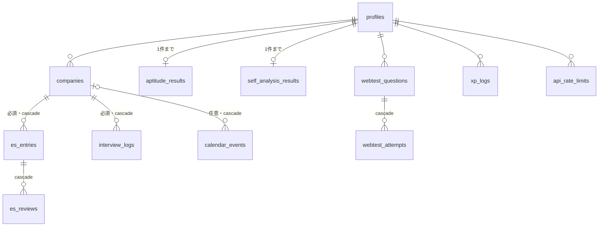

# データベーススキーマ リファレンス

- 実体: `supabase/migrations/*.sql`（Supabase CLI で管理する。master へのリリースで GitHub Actions が本番に適用する）
- 設計の判断とその理由: [backend-design.md](./backend-design.md) の4章
- Go の型: `backend/internal/db/`（sqlc が migrations と `backend/internal/db/queries/` から生成する）

## 方針

- データの読み書きは バックエンドだけが行う。バックエンドはRLSの対象外のロールで接続し、すべての問い合わせを `user_id` で絞り込む
- 全テーブルでRLSは有効だが、ポリシーは作らない。Supabase が公開している Data API からは `anon` / `authenticated` ロールで一切読み書きできない
- すべての `user_id` は `auth.users(id)` を `on delete cascade` で参照し、`not null`
- `updated_at` を持つテーブルは、`moddatetime` のトリガーで更新時刻を自動で入れる
- 決まった値の列は Postgres の enum。値は英語のコードで、日本語の表示名はフロントエンドが持つ

## ER図（概略）

（`profiles` 以外のテーブルも、実際は `auth.users` を直接参照している）

## enum

| 型                    | 値                                                                                                                                                   |
| --------------------- | ---------------------------------------------------------------------------------------------------------------------------------------------------- |
| `company_stage`       | `not_entered`, `entered`, `screening`, `interviewing`, `offered`, `rejected`, `declined`                                                             |
| `es_status`           | `draft`, `submitted`                                                                                                                                 |
| `calendar_event_type` | `es`, `interview`, `intern`, `other`                                                                                                                 |
| `interview_format`    | `in_person`, `online`, `hybrid`                                                                                                                      |
| `xp_action`           | `es_submitted`, `interview_log`, `company_new`, `aptitude_complete`, `self_analysis_complete`, `webtest_question_create`, `webtest_attempt_complete` |

## テーブル

| テーブル                | 主な列                                                                                                                 | 制約・備考                                                                                                                                               |
| ----------------------- | ---------------------------------------------------------------------------------------------------------------------- | -------------------------------------------------------------------------------------------------------------------------------------------------------- |
| `profiles`              | id, full_name, university, faculty, avatar_id, target_industry, career_axis, goal_state, xp, level                     | 行が無いユーザーは、最初の `GET /v1/me` で作る。XP・レベルはXP付与のトランザクションで更新する                                                           |
| `companies`             | id, user_id, name, normalized_name, industry, url, mypage_id, mypage_url, memo, stage, preference, favorite, ai_result | `(user_id, normalized_name)` がユニーク（正規化はGo）。`preference` は1〜5。`ai_result` はAI企業分析の分析結果（1回だけ）                                |
| `es_entries`            | id, user_id, company_id, position, title, status, content_md, questions(jsonb), tags, deadline, memo, ai_result        | `company_id` は必須。`position` は職種・募集枠。`questions` は `[{prompt, answer, charLimit}]`。締切はカレンダーにも表示される                           |
| `es_reviews`            | id, user_id, es_entry_id, ai_result(jsonb), created_at                                                                 | ESのAI添削の履歴。`ai_result` は設問ごとの3観点の点数・改善点・修正版と、添削したときの設問・回答。`es_entries.ai_result` は次のリリースで削除する       |
| `interview_logs`        | id, user_id, company_id, format, round, interview_date, questions(jsonb), improvement, unexpected, ai_result           | `company_id` は必須。`questions` は `[{question, answer, rating}]`。`round` は回次（一次・最終など）                                                     |
| `calendar_events`       | id, user_id, company_id, title, type, date, time                                                                       | `company_id` は任意                                                                                                                                      |
| `xp_logs`               | id, user_id, xp, action, ref_id, created_at                                                                            | `(user_id, action, ref_id)` がユニーク。`(user_id, action, created_at)` にインデックス                                                                   |
| `aptitude_results`      | id, user_id, answers(jsonb), ai_result                                                                                 | `user_id` がユニーク（1人1件）                                                                                                                           |
| `self_analysis_results` | id, user_id, answers(jsonb), ai_result                                                                                 | `user_id` がユニーク（1人1件）                                                                                                                           |
| `webtest_questions`     | id, user_id, title, body, test_type, choices(jsonb), answer, explanation, category, format, difficulty, time_limit     | ユーザーが自分で作る問題                                                                                                                                 |
| `webtest_attempts`      | id, user_id, question_id, is_correct, time_spent                                                                       | 正誤はバックエンドが判定する                                                                                                                             |
| `api_rate_limits`       | user_id, bucket, window_start, count                                                                                   | AI・問い合わせの回数制限。`(user_id, bucket)` が主キーで、1つのSQL文で加算と判定を行う                                                                   |
| `api_app_rate_limits`   | bucket, window_start, count                                                                                            | ユーザーに結び付かない回数制限（AI・問い合わせのアプリ全体の上限、ログインしていない人の問い合わせのIPごとの上限）。IPはハッシュにして `bucket` に入れる |

## マイグレーションの書き方

- `supabase migration new <名前>` でファイルを作る
- master へのリリースで本番に適用され、成功してから Vercel にデプロイされる。適用してからデプロイが終わるまでは古いコードが新しいDBで動くので、**1つ前のバージョンのコードでも動く形で書く**（列の追加が先、不要な列の削除は次のリリース）
- スキーマを変えたら、`backend` で `go generate ./...` を実行して sqlc のコードを更新する
