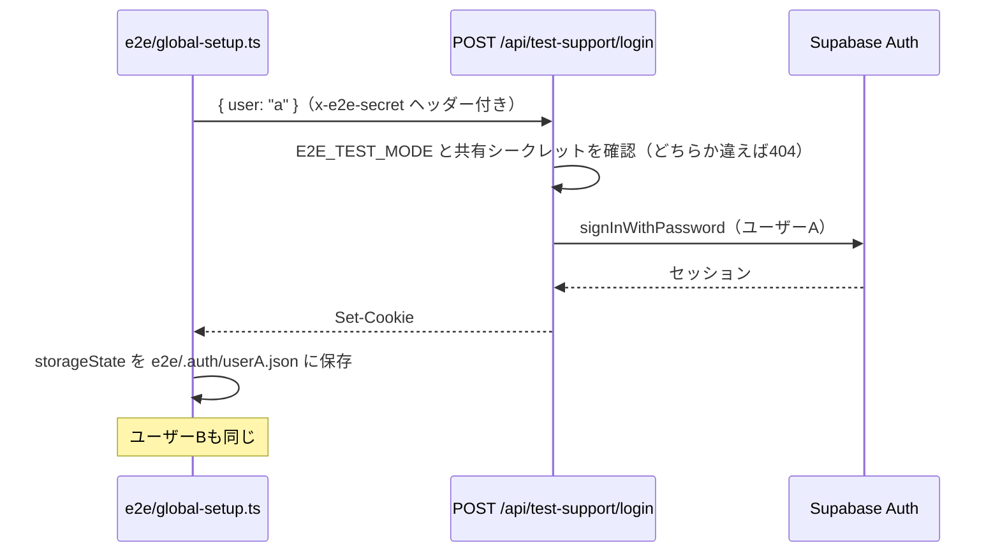

# E2Eテスト設計書（Playwright）

- 関連Issue: [#78 test: Playwright による E2E テストの導入](https://github.com/Yamada040/job-seeker/issues/78)
- 単体テストの設計: [unit-test-plan.md](./unit-test-plan.md)

## 1. 方針

- **本番の Supabase に、E2E専用のテストユーザーを2人（A・B）作って流用する**。専用のプロジェクトを作る手間を避けるため
- Google のログイン画面は自動化できない（Google が自動化したログインを弾く）。そのため、テスト専用のログインAPIでパスワードログインし、セッションの Cookie を Playwright に保存して使い回す
- テストユーザーは、Supabase の画面であらかじめ作っておく。E2E が自動で作るには全権限の secret キーが要り、それをCIに置きたくないため

## 2. 対象のフロー

| フロー                                                                       | ファイル                               | 状態                                                |
| ---------------------------------------------------------------------------- | -------------------------------------- | --------------------------------------------------- |
| 未ログインで保護されたページを開くと `/login` に転送される                   | `e2e/unauthenticated-redirect.spec.ts` | 動いている                                          |
| ログイン画面から Google のログインへ進める・ログイン後にダッシュボードが出る | `e2e/login.spec.ts`                    | 動いている                                          |
| ESを作ると一覧に出る / ユーザーAのESをユーザーBは見られない                  | なし                                   | E2Eでバックエンドを起動する方法を決めてから書き直す |

E2E は本番ビルドの Next.js だけを起動しており、`/v1` を受けるバックエンドがいない。データを扱うフローは、バックエンドを起動する方法（本番の Supabase につなぐか、CIで Supabase を手元に立てるか）を決めてから書く。

## 3. テスト専用のログイン

- `POST /api/test-support/login` は、`E2E_TEST_MODE === "true"` かつ `x-e2e-secret` ヘッダーが `E2E_TEST_SECRET` と一致するときだけ動き、それ以外は404を返す
- 本文で選べるのは `"a"` か `"b"` だけで、メールアドレスやパスワードは受け取らない（任意のアカウントでログインできないようにする）
- `@supabase/ssr` の Cookie の形式を真似せず、アプリと同じ `createSupabaseServerActionClient` でログインさせる（形式はライブラリの内部の都合で変わりうるため）
- 環境変数が足りないときは、`global-setup.ts` が警告を出し、ログインが必要なテストはスキップされる

## 4. 準備

1. Supabase → Authentication → Users → Add user → Create new user で、テストユーザーを2人作る（Auto Confirm User にチェック）。メールアドレスは一目でテスト用と分かるものにする
2. 同じメールアドレスとパスワード、共有シークレット（`openssl rand -hex 32`）を `infra/terraform.tfvars` の `e2e` に入れて `terraform apply` する（GitHub の Secrets に登録される）
3. 手元で実行するときは、同じ値を `.env.test.local`（git の対象外）に置く

| 環境変数                                                                                              | 用途                                           |
| ----------------------------------------------------------------------------------------------------- | ---------------------------------------------- |
| `NEXT_PUBLIC_SUPABASE_URL` / `NEXT_PUBLIC_SUPABASE_PUBLISHABLE_KEY`                                   | Next.js のビルドとログイン                     |
| `E2E_TEST_MODE`                                                                                       | `true` のときだけテスト専用のログインAPIが動く |
| `E2E_TEST_SECRET`                                                                                     | テスト専用のログインAPIの共有シークレット      |
| `E2E_TEST_USER_EMAIL` / `E2E_TEST_USER_PASSWORD` / `E2E_TEST_USER2_EMAIL` / `E2E_TEST_USER2_PASSWORD` | テストユーザーA・B                             |

## 5. CI

- `.github/workflows/test.yml` の `e2e` ジョブで実行する。`E2E_TEST_SECRET` が未設定の間は自動でスキップする
- ジョブの `if:` では `secrets` を直接参照できないため、前段の `check-e2e-secrets` ジョブで有無を判定し、その出力を見る

## 6. 本番の Supabase を流用する危険と対策

| 危険                                   | 対策                                                                                                                     |
| -------------------------------------- | ------------------------------------------------------------------------------------------------------------------------ |
| `E2E_TEST_MODE` を本番に設定してしまう | 本番の Vercel には**絶対に設定しない**。万一設定しても、共有シークレットを知らなければテスト専用のログインAPIは404を返す |
| テストユーザーのパスワードが漏れる     | 見られるのはテストユーザー自身のデータだけ。AIの回数制限（1人1日20回）があるので、料金の被害も小さい                     |
| テストのデータが残る                   | データを扱うフローを書き直すときに、後片付けの方法（テストユーザー自身の削除操作など）もあわせて決める                   |
