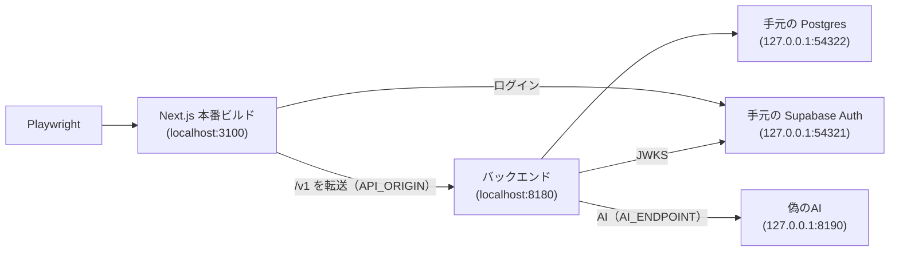

# E2Eテスト設計書（Playwright）

- 関連Issue: [#78 test: Playwright による E2E テストの導入](https://github.com/Yamada040/job-seeker/issues/78)
- 単体テストの設計: [unit-test-plan.md](./unit-test-plan.md)

## 1. 方針

- **本番ではなく、手元・CIで起動した Supabase（`supabase start`）につなぐ**。画面・バックエンド・認証・DBを、本番と同じ組み合わせで動かして確かめる
- 本番の Supabase は、メールアドレスでのログインを止めている（公開されている publishable キーで、誰でもアカウントを量産できてしまうため）。そのため、本番にはテストユーザーを置かない
- Google のログイン画面は自動化できない（Google が自動化したログインを弾く）。テストユーザーはメールアドレスとパスワードでログインし、セッションの Cookie を Playwright に保存して使い回す

採らなかった案: 本番の Supabase にテストユーザーを置いて流用する。手間は少ないが、本番にメールアドレスでのログインとテスト用の値を残すことになり、テストのデータも本番に残る。

## 2. 対象のフロー

| フロー                                                                                      | ファイル                               |
| ------------------------------------------------------------------------------------------- | -------------------------------------- |
| 未ログインで保護されたページを開くと `/login` に転送される                                  | `e2e/unauthenticated-redirect.spec.ts` |
| ログイン画面から Google のログインへ進める・ログイン後にダッシュボードが出る                | `e2e/login.spec.ts`                    |
| 企業をその場で登録してESを保存すると、一覧に出る                                            | `e2e/es-creation.spec.ts`              |
| ユーザーAのESは、ユーザーBの一覧に出ず、URLを直接開いても見られない                         | `e2e/user-isolation.spec.ts`           |
| 企業・ES・面接ログ・Webテスト・予定・プロフィールの主な操作のボタンが動き、結果が画面に出る | `e2e/main-actions.spec.ts`             |
| AI添削（ES）・AI振り返り（面接ログ）・自己分析と適性の保存とAIの実行                        | `e2e/ai.spec.ts`                       |
| ホームの入力欄からAI企業分析を始め、結果や失敗が画面に出る                                  | `e2e/quick-analysis.spec.ts`           |
| 問い合わせ（ログインしていないとき・ログイン中。メールの送信の設定が無いときの案内）        | `e2e/contact.spec.ts`                  |
| 無いURL・無いデータを開くと、見つからない画面が出て戻れる                                   | `e2e/not-found.spec.ts`                |
| スマホの幅で主要な画面が横にはみ出さず、下のメニューで移れる                                | `e2e/narrow-mobile-layout.spec.ts`     |

Google のログインへ進むことは、手元の Supabase に設定したダミーのクライアント（`supabase/config.toml`）で確かめる。Google の画面に遷移した時点で止め、実際にはログインしない。

## 3. 起動するもの



- `playwright.config.ts` が `supabase status` から URL とキーを読み、バックエンドと Next.js を起動する。手元で `npm run dev` しているサーバーとぶつからないよう、E2E 専用のポートを使う
- 本番では `vercel.json` の Services が `/v1` をバックエンドに振り分けるが、E2E では Next.js が `API_ORIGIN` に転送する（`next.config.ts`）
- AIは、E2E 専用の偽の OpenAI 互換サーバー（`e2e/fake-ai/server.mjs`）が答える。バックエンドは `AI_PROVIDER=gpt` と `AI_ENDPOINT` でそこを向き、本番と同じ呼び出し・応答の読み取り・保存の流れを通る。機能はプロンプトの指示の文言で見分けて、各機能が期待する形（ESの添削は JSON）で答える。プロンプトに「AI失敗」があれば失敗を返すので、失敗したときの画面もこれで確かめる
- 手元の Supabase は、既定では従来の HS256 でトークンに署名し、バックエンドはそれを受け付けない。そこで `npm run supabase:signing-key` で ES256 の鍵を作り、本番と同じ方式で署名させる。鍵は手元・CI専用で、git の対象外にしている

## 4. テスト専用のログイン

- `e2e/global-setup.ts` が、手元の Supabase の管理APIでテストユーザーA・Bを作る（2回目以降は既にあるのでそのまま）
- 続けて `POST /api/test-support/login` でログインし、`storageState` を `e2e/.auth/` に保存する
- このルートは、`E2E_TEST_MODE === "true"` かつ `x-e2e-secret` ヘッダーが `E2E_TEST_SECRET` と一致するときだけ動き、それ以外は404を返す。本文で選べるのは `"a"` か `"b"` だけで、メールアドレスやパスワードは受け取らない
- `@supabase/ssr` の Cookie の形式を真似せず、アプリと同じ `createSupabaseServerActionClient` でログインさせる（形式はライブラリの内部の都合で変わりうるため）
- テストユーザーのメールアドレス・パスワードと共有シークレットは、手元の Supabase にしか意味が無いので、`e2e/support/local-supabase.ts` に固定で置く

### AIを使うテストのユーザー

AIを使うテストは、ユーザーA・Bではなく、テストごとに新しく作るユーザーで行う（`e2e/support/new-user.ts`）。適性診断・自己分析は1人1回だけで、AIの回数制限（1人1日20回、企業分析は3回）も手元の Supabase に残り続けるため、同じユーザーでは2回目の実行や `--repeat-each` で失敗する。作ったユーザーはテストの後に消し、その人のデータもまとめて消える。

テスト専用のログインはユーザーA・Bしか選べないので、新しいユーザーはテストの側で `@supabase/ssr` を使ってログインし、書き込まれた Cookie をブラウザに渡す。アプリ全体のAIの1日の上限は、E2E では当たらない値にして起動する（`playwright.config.ts`）。

## 5. 手元での実行

```bash
npm run supabase:signing-key   # 最初の1回だけ
supabase start -x studio,imgproxy,storage-api,realtime,edge-runtime,logflare,vector,mailpit,postgres-meta,postgrest,supavisor
npm run test:e2e
```

手元の Supabase のデータは実行のたびに残る。テストは企業名やタイトルに時刻を入れ、前回までのデータと区別している。

## 6. CI

`.github/workflows/ci.yml` の `e2e` ジョブで、Supabase を起動してから実行する。認証・DB・その前段の API ゲートウェイだけを起動し、使わないもの（Studio・Storage・Data API など）は起動しない。

## 7. セキュリティ上の注意

- 本番の Vercel には **`E2E_TEST_MODE` を絶対に設定しない**。万一設定しても、共有シークレットを知らなければテスト専用のログインは404を返し、本番にはメールアドレスでログインできるユーザーもいない
- 手元の Supabase の署名鍵（`supabase/signing_keys.json`）はコミットしない。コミットの前のフックがファイル名で止める
